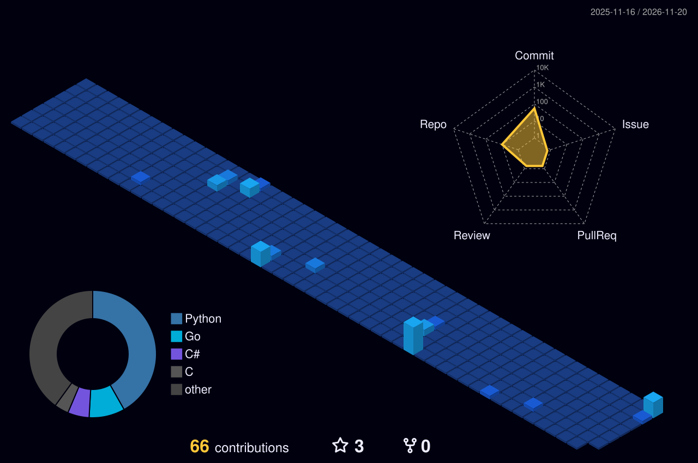

# Md Shoaib Mahmud

**I enjoy exploring Linux, building practical software, and learning how systems work.**

  
  
  

---

## 👋 About Me

I'm a Computer Science and Engineering student interested in **Linux, systems software, desktop applications, and developer tools**. I like learning by building: taking an idea, exploring how it works, writing the code, testing it, and improving the result.

- 🐧 Interested in Linux and the open-source ecosystem.
- 🛠️ Enjoy building practical utilities and desktop tools.
- 💻 Exploring systems programming, automation, and application development.
- 🚀 Focused on learning, experimenting, and shipping useful projects.

## 🧰 Tech Stack

### Languages and Web Technologies

  

### Tools and Platforms

  

  
  
  

## 🚀 Featured Projects

<table>
  <tr>
    <td width="50%" valign="top">
      <h3 align="center">🖼️ scompress</h3>
      

        
      

      
A local-first Linux image compressor with a standalone CLI and native GTK desktop interface.

      

        
      

    </td>
    <td width="50%" valign="top">
      <h3 align="center">🧹 AppSweep</h3>
      

        
      

      
A Linux application removal utility for APT, Snap, and Flatpak.

      

        
      

    </td>
  </tr>
  <tr>
    <td width="50%" valign="top">
      <h3 align="center">📊 SysMon Linux</h3>
      

        
      

      
Native Linux system monitoring and performance information.

    </td>
    <td width="50%" valign="top">
      <h3 align="center">🔋 Lenovo Power Control</h3>
      

        
      

      
A Linux-focused project for Lenovo power control.

    </td>
  </tr>
  <tr>
    <td width="50%" valign="top">
      <h3 align="center">⚙️ Ubuntu Setup Engine</h3>
      

        
      

      
Tools for setting up and configuring an Ubuntu environment.

    </td>
    <td width="50%" valign="top">
      <h3 align="center">🌱 More Projects</h3>
      
I keep experimenting with ideas and building small tools. Explore my repositories to see what I'm working on.

      

        
      

    </td>
  </tr>
</table>

## 📈 GitHub Activity

 

 

---

### Code. Learn. Improve. Ship.

*Building, learning, and improving one project at a time.*

<a href="https://shoaib.tech">Website</a> · <a href="mailto:shoaibxbd@gmail.com">Email</a> · <a href="https://github.com/mrshoaibxbd">GitHub</a>

