  

  <h1>Md Shoaib Mahmud</h1>

  

    <strong>Computer Science & Engineering Student</strong>
     
    Linux Enthusiast · Systems Developer · Software Engineer
  

  

    
    
    
  

---

## About Me

I'm a Computer Science and Engineering student with a strong interest in Linux, software development, and understanding how computer systems work.

I enjoy exploring the Linux ecosystem, developing useful utilities, building native desktop applications, and automating everyday tasks.

I believe in learning by building, experimenting with ideas, and continuously improving the things I create.

**My interests**
- Linux and system-level development
- Native desktop applications
- Programming and software engineering
- Command-line tools and automation
- Open-source software

---

## Technologies

**Languages**

  

**Tools & Platforms**

  

  
  
  
  
  

---

## Selected Projects

A few things I've been working on.

<table>
  <tr>
    <td width="50%" valign="top">

### [scompress](https://github.com/mrshoaibxbd/scompress)

A local-first Linux image compressor featuring a standalone Go command-line engine and a native C + GTK4 desktop application.

    </td>
    <td width="50%" valign="top">

### [AppSweep](https://github.com/mrshoaibxbd/appsweep)

A Linux application removal utility for managing APT, Snap, and Flatpak applications safely.

    </td>
  </tr>
  <tr>
    <td width="50%" valign="top">

### [SysMon Linux](https://github.com/mrshoaibxbd/sysmon-linux)

Native Linux system monitoring and performance information.

    </td>
    <td width="50%" valign="top">

### [Lenovo Power Control](https://github.com/mrshoaibxbd/lenovo-power-control)

A project focused on Lenovo laptop power management.

    </td>
  </tr>
  <tr>
    <td colspan="2" valign="top">

### [Ubuntu Setup Engine](https://github.com/mrshoaibxbd/ubuntu-setup-engine)

A project focused on Ubuntu system setup and configuration.

    </td>
  </tr>
</table>

---

## GitHub Activity

  

  

    

  

---

## A Little About My Mindset

  

    <strong>"Talk is cheap. Show me the code."</strong>
     
    — Linus Torvalds
  

  

    <strong>Code. Learn. Improve. Ship.</strong>
  

  

    <strong>Discipline today. Freedom tomorrow.</strong>
  

---

  

  

    <strong>Building, learning, and improving one project at a time.</strong>
  

  

    <a href="https://shoaib.tech">Website</a>
    &nbsp;·&nbsp;
    <a href="mailto:shoaibxbd@gmail.com">Email</a>
    &nbsp;·&nbsp;
    <a href="https://github.com/mrshoaibxbd">GitHub</a>
  

  Thanks for visiting my profile.

