  

  <h1>Md Shoaib Mahmud</h1>

  <h3>Computer Science & Engineering Student · Linux Enthusiast · Systems Developer</h3>

  

    
    
    
  

  

    
  

---

## About Me

I'm a Computer Science and Engineering student interested in understanding how software and operating systems work beneath the surface.

I enjoy exploring Linux, developing system utilities, building desktop applications, automating repetitive tasks, and turning practical ideas into useful software.

I believe in learning by building, experimenting, debugging, and continuously improving.

**Currently interested in:**
- Linux systems and software development.
- C and Go programming.
- Native Linux desktop application development.
- Automation and command-line utilities.
- Software architecture and open-source development.

---

## Technologies & Tools

### Programming Languages

  

### Development Tools & Platforms

  

  
  
  

---

## Linux & Command-Line Development

Linux is one of my main areas of interest. I enjoy working with the terminal, understanding system behaviour, developing automation tools, and exploring how Linux applications interact with the operating system.

I particularly enjoy building tools that make everyday Linux tasks easier.

---

## Featured Projects

### 1. scompress

A local-first Linux image compression utility featuring a standalone Go command-line engine and a native C + GTK4 desktop application.

### 2. AppSweep

Safe Linux application removal for APT, Snap, and Flatpak.

### 3. SysMon Linux

Native Linux system monitoring and performance information.

### 4. Lenovo Power Control

### 5. Ubuntu Setup Engine

---

## My Development Philosophy

| LEARN | BUILD | IMPROVE |
|:---:|:---:|:---:|
| Explore new concepts | Turn ideas into software | Refine and optimize |

 

**Learn continuously. Build thoughtfully. Improve consistently.**

---

## GitHub Activity

  

  

    

  

---

  

  <h3>Building, learning, and improving one project at a time.</h3>

  

    <a href="https://shoaib.tech">Website</a>
    &nbsp;·&nbsp;
    <a href="mailto:shoaibxbd@gmail.com">Email</a>
    &nbsp;·&nbsp;
    <a href="https://github.com/mrshoaibxbd">GitHub</a>
  

  Thanks for visiting my profile! ✨

